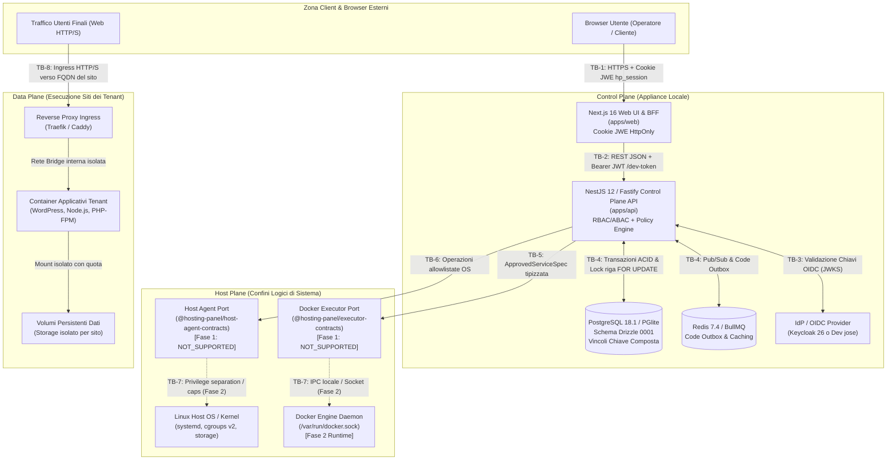
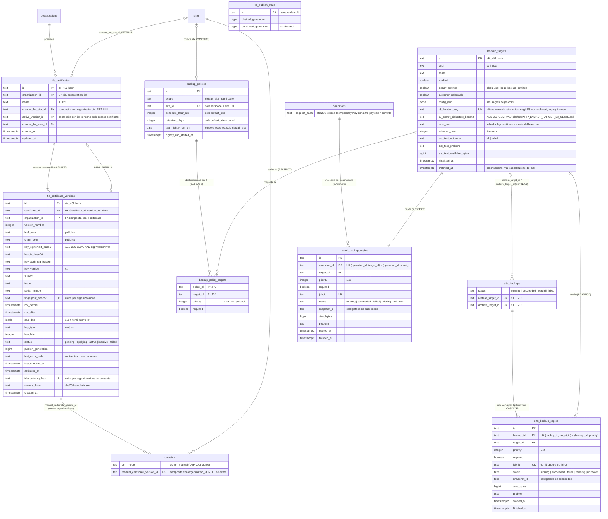
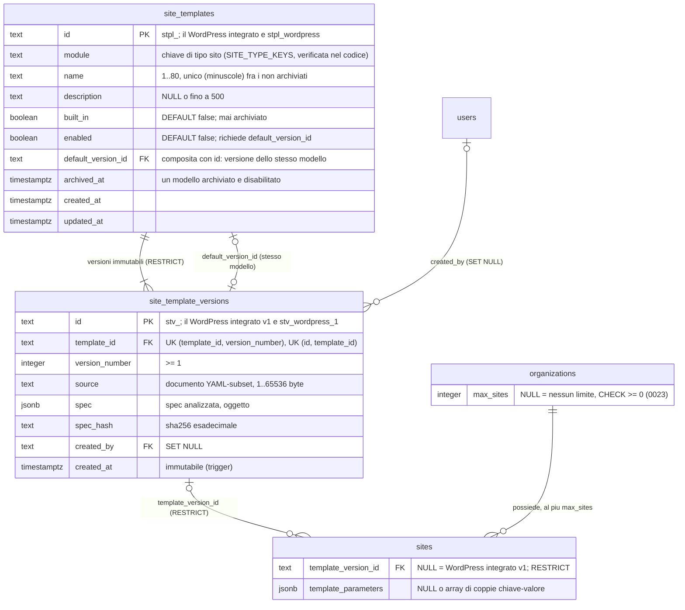
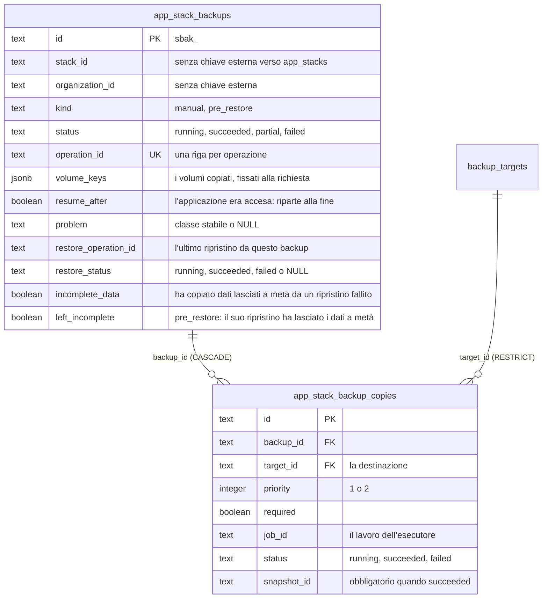
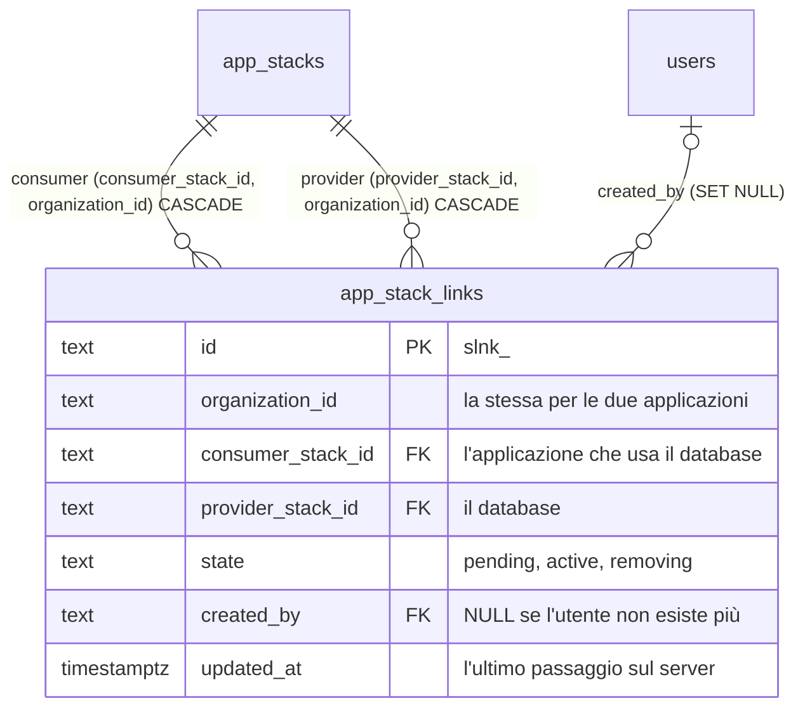
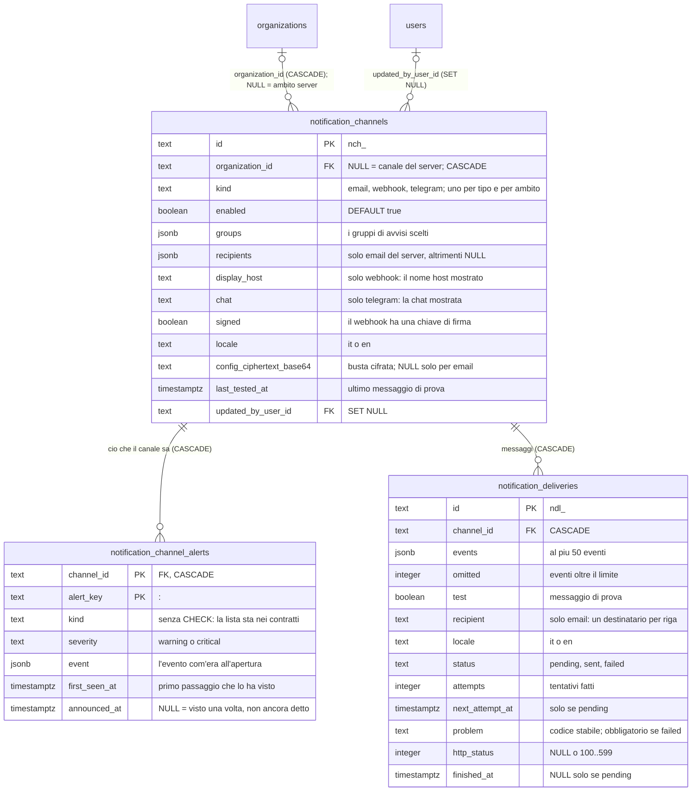
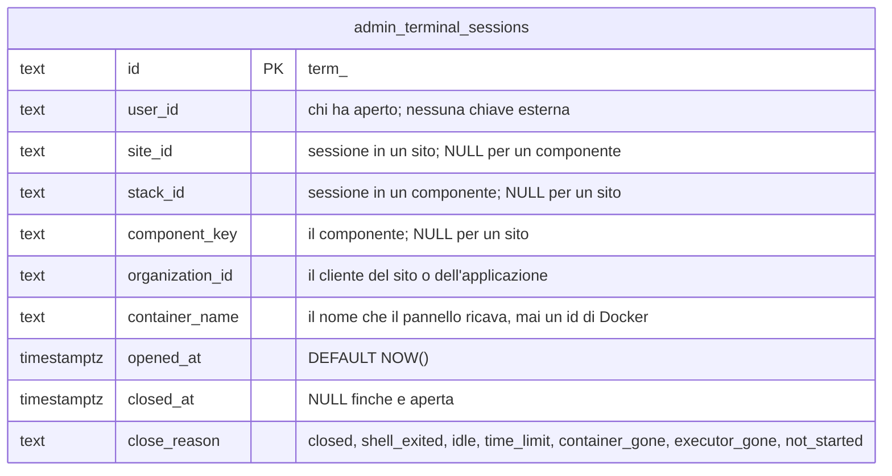

# Diagrammi Architetturali, Confini di Fiducia e Modello ER (`HCP-SPEC-002`)

- **Data:** 2026-11-07  
- **Riferimento di specifica:** `HCP-SPEC-002` §2, §3, §5.1, §8 Step 2  
- **Stato:** Normativo / Approvato  

---

## 1. Mappa dei Piani Architetturali e gli 8 Confini di Fiducia (Trust Boundaries)

L'architettura della piattaforma è rigorosamente suddivisa in tre piani ortogonali:
- **Control Plane**: Interfaccia utente web, API REST modulare NestJS, motore policy RBAC/ABAC, outbox transazionale e persistenza PostgreSQL/Redis.
- **Host Plane**: Confini di esecuzione verso il motore container e i servizi di sistema operativo host (interfacce contrattuali tipizzate).
- **Data Plane**: Flusso applicativo diretto degli utenti finali verso i siti ospitati (ingress reverse proxy, container applicativi, database dei siti, volumi di storage).



### Tabella dei Confini di Fiducia (Trust Boundaries)

| ID Confine | Nome del Confine | Canale / Protocollo | Misure di Sicurezza Applicate |
| :--- | :--- | :--- | :--- |
| **TB-1** | Browser <-> Web BFF | HTTPS / HTTP (127.0.0.1) | Cookie crittografato JWE `hp_session` (`HttpOnly`, `SameSite=Lax`), sanitizzazione perimetrale DTO (zero token o secret nel DOM), protezione CSRF. |
| **TB-2** | Web BFF <-> API Control Plane | REST / JSON su rete interna | Token Bearer JWT verificato tramite `jose`, contesto organizzativo in sessione, separazione rigida dei tre namespace (`/admin`, `/hosting`, `/o/:orgSlug`). |
| **TB-3** | Control Plane API <-> IdP OIDC | HTTPS / OIDC Protocol | Verifica firma crittografica token con JWKS dinamico o emulatore dev `jose`; rifiuto categorico di algoritmi insicuri (`none`). |
| **TB-4** | Control Plane API <-> PostgreSQL/Redis | TCP / Unix Socket locale | Connessioni autenticate, transazioni ACID, vincoli di chiave composta relazionale `(organization_id, id)`, trigger anti-manomissione su audit/revisioni. |
| **TB-5** | Control Plane API <-> Docker Executor | Interfaccia TypeScript tipizzata | Disaccoppiamento assoluto tramite `@hosting-panel/executor-contracts`; specifiche validate `ApprovedServiceSpec`; stub Fase 1 `NOT_SUPPORTED`. |
| **TB-6** | Control Plane API <-> Host Agent | Interfaccia TypeScript tipizzata | Contratto tassativo `@hosting-panel/host-agent-contracts`; diniego esplicito a `hosting_admin` (`AC-F1-03`); stub Fase 1 `NOT_SUPPORTED`. |
| **TB-7** | Agenti <-> OS Host & Docker Daemon | Socket Unix / IPC (Fase 2) | Separazione di privilegi; accesso a `/var/run/docker.sock` confinato; rimozione capability Linux pericolose (`CAP_SYS_ADMIN`). |
| **TB-8** | Ingress <-> Container dei Tenant | Reti Bridge Docker | Segmentazione di rete per `Site`; nessun cross-talk inter-container tra siti differenti; terminazione TLS con certificati dedicati. |

#### Confini aggiunti da ADR-0035

| ID Confine | Nome del Confine | Canale / Protocollo | Misure di Sicurezza Applicate |
| :--- | :--- | :--- | :--- |
| **TB-9** | Container di uno stack <-> Rete privata dello stack | Rete bridge Docker `hp_appnet_<stackId>` (`Internal: true`) | Una rete per stack, ruolo `app_internal`; nessuna rete della piattaforma (né `hp_ingress_net` né quella del database condiviso); bridge semplice senza l'opzione `com.docker.network.bridge.name`, così il nome `br-*` resta e la regola del firewall che scarta il traffico verso il metadata (`169.254.0.0/16`, `fd00:ec2::254`) vale anche qui; i componenti si trovano per nome solo dentro lo stesso stack. |
| **TB-10** | Proxy <-> Rete edge dello stack | Rete bridge Docker `hp_appedge_<stackId>` + file Traefik `app_<stackId>.yml` | Esiste solo se il piano ha un ingresso; la raggiungono solo i componenti d'ingresso e il proxy, che non entra mai nella rete privata; route pubblicate solo dopo che il bersaglio è sano, in un file proprio dello stack (i file `site_*.yml` e `hp-panel.yml` non si riscrivono); certificati solo ACME. |

---

## 2. Diagramma Entità-Relazione (Schema Relazionale PostgreSQL Fase 1)

Il modello dati di persistenza è definito in `@hosting-panel/database` tramite Drizzle ORM e codificato nella migrazione canonica `0001_phase1_docker_native.sql`:

```mermaid
erDiagram
    platform_installations ||--o{ hosts : "gestisce"
    platform_installations ||--o{ service_templates : "fornisce catalogo"
    hosts ||--o{ host_allocations : "assegnato tramite"
    organizations ||--o{ host_allocations : "detiene allocazione su"
    organizations ||--o{ sites : "possiede"
    organizations ||--o{ resource_quotas : "soggetta a"
    organizations ||--o{ quota_reservations : "riserva risorse in"
    organizations ||--o{ operations : "registra mutazioni"
    organizations ||--o{ audit_events : "traccia eventi immutabili"
    
    sites ||--o{ domains : "mappato su"
    sites ||--o{ service_instances : "composto da"
    
    service_templates ||--o{ service_instances : "istanziato da"
    
    service_instances ||--o{ stack_revisions : "versionato in"
    service_instances ||--o| observed_states : "osservato in"
    
    stack_revisions ||--o{ docker_resources : "dichiara risorse"

    platform_installations {
        uuid id PK
        varchar version
        varchar mode
        varchar status
        timestamp created_at
        timestamp updated_at
    }

    hosts {
        uuid id PK
        uuid installation_id FK
        varchar name
        varchar hostname
        varchar ipv4_address
        varchar hosting_mode "dedicated | shared"
        varchar status "online | offline | maintenance"
        jsonb hardware_specs
        timestamp created_at
        timestamp updated_at
    }

    organizations {
        uuid id PK
        varchar name
        varchar slug UK
        varchar status "active | suspended"
        timestamp created_at
        timestamp updated_at
    }

    host_allocations {
        uuid id PK
        uuid host_id FK
        uuid organization_id FK
        varchar hosting_mode "dedicated | shared"
        varchar status "active | released"
        timestamp allocated_at
        timestamp released_at
    }

    sites {
        uuid id PK
        uuid organization_id FK
        uuid host_allocation_id FK
        varchar name
        varchar slug
        varchar status "provisioning | active | stopped | degraded"
        timestamp created_at
        timestamp updated_at
    }

    service_templates {
        uuid id PK
        varchar name
        varchar slug UK
        varchar category "web | database | cache | worker"
        varchar version
        jsonb default_spec
        boolean is_active
        timestamp created_at
    }

    service_instances {
        uuid id PK
        uuid site_id FK
        uuid organization_id FK
        uuid template_id FK
        varchar name
        varchar service_type
        varchar status "pending | running | stopped | error"
        uuid current_revision_id FK
        timestamp created_at
        timestamp updated_at
    }

    stack_revisions {
        uuid id PK
        uuid service_instance_id FK
        uuid organization_id FK
        integer revision_number
        varchar spec_hash "SHA-256 immutabile"
        jsonb service_spec
        varchar status "applied | superseding | failed"
        timestamp created_at
    }

    docker_resources {
        uuid id PK
        uuid stack_revision_id FK
        uuid service_instance_id FK
        varchar resource_type "container | volume | network"
        varchar logical_name
        jsonb attributes
        timestamp created_at
    }

    observed_states {
        uuid id PK
        uuid service_instance_id FK UK
        varchar runtime_status "running | exited | restarting | dead"
        varchar drift_status "in_sync | drifted | unknown"
        jsonb inspected_state
        timestamp last_observed_at
    }

    domains {
        uuid id PK
        uuid site_id FK
        uuid organization_id FK
        varchar fqdn UK "canonical lowercase"
        boolean is_primary
        varchar tls_status "pending | ready | error | none"
        timestamp created_at
    }

    resource_quotas {
        uuid id PK
        uuid organization_id FK UK
        integer max_cpu_millicores
        bigint max_memory_bytes
        bigint max_disk_bytes
        integer max_sites
        integer max_domains
        timestamp created_at
        timestamp updated_at
    }

    quota_reservations {
        uuid id PK
        uuid organization_id FK
        uuid operation_id FK
        integer reserved_cpu_millicores
        bigint reserved_memory_bytes
        bigint reserved_disk_bytes
        varchar status "reserved | committed | released"
        timestamp expires_at
        timestamp created_at
    }

    operations {
        uuid id PK
        uuid organization_id FK
        varchar entity_type
        uuid entity_id
        varchar operation_type
        varchar status "queued | processing | succeeded | failed | unknown | cancelled"
        varchar idempotency_key UK
        jsonb payload
        text error_message
        timestamp started_at
        timestamp completed_at
    }

    audit_events {
        uuid id PK
        uuid organization_id FK
        uuid actor_user_id
        varchar actor_role
        varchar action
        varchar resource_type
        uuid resource_id
        jsonb metadata
        varchar ip_address
        timestamp timestamp "immutabile trigger-protected"
    }
```

### 2.1 Estensione `HCP-SPEC-004`: certificati TLS manuali e destinazioni di backup

Le migrazioni `0021_manual_tls_certificates.sql` (`ADR-0031`) e `0022_backup_targets_and_copies.sql` (`ADR-0032`) sono additive: ogni colonna aggiunta a una tabella esistente è `NULL` o ha un `DEFAULT`, così la release precedente continua a funzionare dopo un rollback automatico. Il diagramma riporta solo le tabelle nuove e le colonne nuove o coinvolte delle tabelle esistenti (`domains`, `operations`, `site_backups`); le altre colonne sono nelle migrazioni.



Note di lettura:

- `domains.cert_mode = 'manual'` richiede `manual_certificate_version_id` (CHECK `domains_cert_mode_version_check`); la chiave esterna composita `(manual_certificate_version_id, organization_id)` impedisce che un dominio usi la versione di un'altra organizzazione e rifiuta lo spostamento di un sito con un dominio manuale (`409 CERTIFICATE_IN_USE`).
- `tls_certificate_versions` è immutabile (trigger `trg_prevent_tls_certificate_versions_mutation`): cambiano solo stato e campi di pubblicazione, mai il materiale. Le versioni cadono a cascata con il certificato; nessun testo cifrato della chiave resta dopo la cancellazione.
- `tls_publish_state` ha una sola riga `default`: il contatore di generazione del manifest `hp-manual-certificates.yml`.
- `backup_targets`: al più un target `local` vivo (`uq_backup_targets_one_local`) e uno solo `legacy_settings` (`uq_backup_targets_one_legacy`); il target legacy tiene la sua chiave sincronizzata con `backup_settings` tramite il trigger `trg_backup_settings_sync_legacy_target` e ne legge il segreto cifrato com'è (nessuna ricifratura).
- Le copie sono la fonte di verità dello stato di un backup: `site_backups.status` è l'aggregato (`partial` = almeno una copia riuscita ma non tutte le richieste) e `snapshot_id`/`size_bytes` della riga logica rispecchiano la copia riuscita di priorità più bassa. `ON DELETE RESTRICT` sui target: un target con copie si archivia, non si cancella.

### 2.2 Estensione `ADR-0034` e `ADR-0033`: limite di siti per cliente e modelli di sito

Le migrazioni `0023_organization_site_limit.sql` (`ADR-0034`) e `0024_site_templates.sql` (`ADR-0033`) sono additive: la colonna `organizations.max_sites` è `NULL` (nessun limite) per ogni cliente esistente; le due colonne aggiunte a `sites` sono `NULL` e un sito con `template_version_id` `NULL` è il WordPress integrato alla versione 1. Una release precedente, dopo un rollback automatico, non le nomina mai. Il diagramma riporta le tabelle nuove e le colonne nuove di `organizations` e `sites`.



Note di lettura:

- `site_template_versions` è immutabile (trigger `trg_prevent_site_template_versions_mutation`): nessuna riga si cancella e nessuna colonna cambia, tranne `created_by` che diventa `NULL` se l'utente è rimosso. Una modifica è una nuova versione.
- `ck_site_templates_enabled_needs_default` (un modello abilitato ha una versione predefinita), `ck_site_templates_archived_disabled` (un modello archiviato è disabilitato) e `ck_site_templates_built_in_not_archived` (il modello integrato non si archivia) tengono coerente il catalogo; la chiave esterna composita `(default_version_id, id)` impedisce una versione predefinita di un altro modello.
- `sites.template_parameters` ha `CHECK jsonb_typeof = 'array'`; l'indice parziale `idx_sites_template_version` serve il conteggio dei siti per versione (elenco e dettaglio dei modelli) e il cancello del downgrade `site-templates`.
- `organizations.max_sites` non ha chiavi esterne: il limite si controlla sotto il blocco di riga dell'organizzazione alla creazione e allo spostamento di un sito (`ADR-0034`).

### 2.3 Estensione ADR-0035: stack applicativi e catalogo dei modelli

La migrazione `0025_app_stacks.sql` (`ADR-0035`) è additiva: dieci tabelle nuove, una colonna nulla (`organizations.max_app_stacks`) e due trigger di unicità degli hostname; nessuna tabella esistente cambia forma e nessuna riga è riscritta. Le tabelle figlie di `app_stacks` lo referenziano con la coppia `(stack_id, organization_id)`, quindi non possono appartenere a un'altra organizzazione. Il diagramma riporta le chiavi, gli stati, gli hash e le chiavi esterne verso `organizations`, `host_allocations`, `users` e `resource_quotas`.

```mermaid
erDiagram
    organizations ||--o{ app_stacks : "possiede, al piu max_app_stacks (CASCADE)"
    host_allocations ||--o{ app_stacks : "(host_allocation_id, organization_id)"
    resource_quotas |o--o{ app_stacks : "resource_quota_id (SET NULL)"
    users |o--o{ app_stacks : "created_by (SET NULL)"
    users |o--o{ app_template_versions : "created_by (SET NULL)"
    app_templates ||--|{ app_template_versions : "versioni immutabili (RESTRICT)"
    app_templates |o--o| app_template_versions : "default_version_id (stesso modello)"
    app_template_versions ||--o{ app_stacks : "(template_version_id, template_id)"
    app_template_versions ||--o{ app_stack_revisions : "template_version_id"
    app_stacks ||--o{ app_stack_parameters : "(stack_id, organization_id) CASCADE"
    app_stacks ||--o{ app_stack_secrets : "versioni immutabili (CASCADE)"
    app_stacks ||--o{ app_stack_revisions : "revisioni immutabili (CASCADE)"
    app_stacks |o--o| app_stack_revisions : "desired_revision_id, applied_revision_id"
    app_stacks ||--o{ app_stack_components : "(stack_id, organization_id) CASCADE"
    app_stacks ||--o{ app_stack_volumes : "(stack_id, organization_id) CASCADE"
    app_stacks ||--o{ app_stack_domains : "(stack_id, organization_id) CASCADE"
    app_stack_components ||--o{ app_stack_domains : "(stack_id, component_key)"
    app_stacks ||--o{ app_stack_deployments : "(stack_id, organization_id) CASCADE"
    app_stacks ||--o{ app_stack_task_schedules : "(stack_id, organization_id) CASCADE (0031)"
    app_stacks ||--o{ app_stack_task_runs : "(stack_id, organization_id) CASCADE (0031)"
    app_stack_revisions |o--o{ app_stack_deployments : "(revision_id, stack_id)"
    app_stack_revisions |o--o{ app_stack_deployments : "(replaced_revision_id, stack_id) (0032)"

    organizations {
        integer max_app_stacks "NULL = nessun limite, CHECK >= 0 (0025)"
    }

    app_templates {
        text id PK "atpl_<id>; cinque integrati (ADR-0035 e ADR-0039)"
        text slug UK "^[a-z][a-z0-9-]{1,47}$"
        text category "^[a-z][a-z0-9-]{0,31}$"
        boolean built_in "DEFAULT false; mai archiviato"
        boolean enabled "DEFAULT false; richiede default_version_id"
        text default_version_id FK "composita con id"
        timestamptz archived_at "un modello archiviato e disabilitato"
    }

    app_template_versions {
        text id PK "atv_<id>"
        text template_id FK "UK (template_id, version_number), UK (id, template_id)"
        integer version_number ">= 1"
        text source "HCP-STACK/v1, 1..65536 byte"
        jsonb compiled_schema "spec tipizzata, senza segreti"
        text spec_hash "sha256 esadecimale"
        text created_by FK "SET NULL"
    }

    app_stacks {
        text id PK "stk_<id>, ^[a-z][a-z0-9_]{0,63}$; UK (id, organization_id)"
        text organization_id FK "CASCADE"
        text host_allocation_id FK "composita con organization_id"
        text template_version_id FK "composita con template_id"
        text status "draft ... running, failed, unknown, delete_failed, deleted"
        text desired_revision_id FK "composita con id"
        text applied_revision_id FK "composita con id"
        text applied_routes_hash "NULL o sha256"
        text applied_addresses_hash "0026: NULL o sha256 degli indirizzi pubblicati"
        text idempotency_key "con request_hash, o entrambi NULL"
        timestamptz deleted_at "non NULL se e solo se status = deleted"
    }

    app_stack_parameters {
        text stack_id PK "con parameter_key"
        text organization_id FK "con stack_id"
        jsonb public_value "solo valori pubblici: stringa, numero, booleano"
    }

    app_stack_secrets {
        text id PK "ssec_<id>"
        text stack_id FK "UK (stack_id, parameter_key, version)"
        text organization_id FK "con stack_id"
        integer version ">= 1; una rotazione e una versione nuova"
        text ciphertext_base64 "AES-256-GCM, AAD legata a organizzazione, stack, parametro e versione"
    }

    app_stack_revisions {
        text id PK "srev_<id>; UK (id, stack_id)"
        text stack_id FK "UK (stack_id, revision_number)"
        text organization_id FK "con stack_id"
        jsonb plan "ApprovedStackPlan senza segreti"
        text plan_hash "sha256 esadecimale"
        jsonb parameters "coppie chiave-valore pubbliche, ordinate"
    }

    app_stack_components {
        text stack_id PK "con component_key"
        text organization_id FK "con stack_id"
        text health "unknown, starting, healthy, unhealthy, stopped, missing"
        text applied_revision_id FK "composita con stack_id"
    }

    app_stack_volumes {
        text stack_id PK "con volume_key"
        text organization_id FK "con stack_id"
        text retention_policy "retain (predefinita) o destroy"
        text status "pending, present, retained, removed, missing"
    }

    app_stack_domains {
        text id PK "sdom_<id>"
        text stack_id FK "con component_key verso app_stack_components"
        text organization_id FK "con stack_id"
        text hostname UK "minuscolo; unico anche fra domains e hosts (trigger)"
        text status "pending, active, failed"
        text cert_status "none, requested, active, failed (solo ACME)"
        timestamptz removal_requested_at "in rimozione: tiene il nome finché un file di route senza di esso non è pubblicato, o NULL (0033)"
    }

    app_stack_deployments {
        text id PK "sdep_<id>"
        text stack_id FK "con organization_id"
        text operation_id UK "una riga per operazione"
        text revision_id FK "NULL quando l'operazione non ha una revisione"
        text status "queued, running, succeeded, failed, unknown, cancelled"
        text problem "codice stabile o NULL"
        text replaced_revision_id FK "revisione desiderata che la richiesta ha sostituito, o NULL (0032)"
        text replaced_status "stato dello stack che la richiesta ha sostituito, o NULL (0032)"
    }

    app_stack_task_schedules {
        text stack_id PK "con task_key; FK con organization_id"
        text task_key PK "chiave dell'attività nel modello"
        text frequency "hourly, daily, weekly (nessuna riga = mai)"
        integer hour_utc "0-23, NULL per hourly"
        integer weekday "1 (lunedì) - 7, solo weekly"
        timestamptz changed_at "prima di questo istante nulla è dovuto"
        timestamptz served_slot_at "ultimo orario già trattato"
        timestamptz skipped_slot_at "ultimo orario non eseguito"
        text skip_reason "busy, not_running, missed"
    }

    app_stack_task_runs {
        text id PK "srun_<24 hex>"
        text stack_id FK "con organization_id"
        text task_key "chiave dell'attività"
        text component_key "componente in cui gira"
        text run_trigger "manual, schedule"
        timestamptz slot_at "orario programmato, UNIQUE per attività"
        text operation_id UK "una riga per operazione (senza FK)"
        text status "queued, running, succeeded, failed, timed_out, not_started, unknown"
        text problem "perché non è partita, o outcome_lost"
        integer exit_code "0-255 o NULL; non esposto al cliente"
        text output "ultime righe, mascherate, al più 16 KiB"
    }
```



Note di lettura:

- Un hostname ha un solo proprietario fra `domains` (siti), `app_stack_domains` (stack) e `hosts` (il pannello): i trigger `trg_app_stack_domains_hostname_claim` e `trg_domains_app_stack_hostname_claim` prendono un advisory lock di transazione sul nome in minuscolo e guardano l'altra tabella; un conflitto è `SQLSTATE 23505` con il nome di vincolo `uq_panel_hostname_claim`, che i codici dei siti già traducono in `DOMAIN_CONFLICT`.
- `app_template_versions`, `app_stack_revisions` e `app_stack_secrets` sono immutabili (trigger); una revisione o una versione di segreto si cancella solo quando il suo stack è cancellato.
- `app_stack_volumes` non perde mai un volume da sola: `retention_policy = 'destroy'` lo scrive solo una cancellazione che chiede di eliminare i dati; altrimenti il volume resta `retained` dopo la cancellazione dello stack.
- `organizations.max_app_stacks` non ha chiavi esterne: il limite si controlla sotto il blocco di riga dell'organizzazione, sugli stack non cancellati, e gli stack non contano mai fra i siti.

### 2.4 Estensione ADR-0038: backup delle applicazioni

La migrazione `0027_app_stack_backups.sql` (`ADR-0038`) è additiva: due tabelle nuove, nessuna tabella esistente cambia forma e nessuna riga è riscritta.



Note di lettura:

- `app_stack_backups` non ha chiavi esterne verso `app_stacks` né verso `organizations`: i backup di un'applicazione cancellata restano finché il periodo di conservazione non è passato, e li toglie solo la pulizia notturna (`stack.prune`).
- Una copia punta alla sua destinazione con `RESTRICT`: una destinazione che conserva copie di applicazioni non si cancella.
- `left_incomplete` ha senso solo sulle righe `pre_restore`, `incomplete_data` su tutte (K5): finché l'ultima operazione dell'applicazione che decide (un ripristino non annullato o un'altra azione riuscita; mai un backup o una pulizia) è un ripristino il cui backup di sicurezza ha `left_incomplete`, la più recente di dati interi non è mai rimossa (K7) e la pagina la indica per tornare indietro.
- `snapshot_id` non esce mai dal database verso un DTO, una riga di audit o un payload dell'outbox.

### 2.5 Estensione ADR-0039: collegamenti fra un database e un'applicazione

La migrazione `0028_app_stack_links.sql` (`ADR-0039`) è additiva: una tabella nuova, nessuna tabella esistente cambia forma e nessuna riga è riscritta.



Note di lettura:

- Le due chiavi esterne composte `(…_stack_id, organization_id)` verso `app_stacks` impediscono di registrare un collegamento fra applicazioni di due organizzazioni.
- Il componente e la porta del database non sono nella riga: si leggono dal suo piano quando il collegamento viene applicato, così un aggiornamento del database non lascia qui un nome vecchio.
- `active` è l'ultima risposta del server, non una lettura continua di Docker; `removing` resta finché il server conferma lo stacco, poi la riga è cancellata.
- Quale delle due applicazioni è il database non è un vincolo della tabella: lo decide la categoria `database` del modello, controllata dall'API alla creazione del collegamento.

### 2.6 Estensione ADR-0040: notifiche

La migrazione `0029_notifications.sql` (`ADR-0040`) è additiva: tre tabelle nuove con i loro indici, nessuna modifica a una tabella esistente. La release precedente non le legge mai.



Note di lettura:

- `notification_channels.organization_id` vuoto è l'ambito del server. Un `UNIQUE (organization_id, kind)` non varrebbe per le righe con `NULL`: l'unicità è data da due indici parziali, uno per ambito.
- L'indirizzo di un webhook, la sua chiave di firma e il token di un bot stanno solo nella busta cifrata (`config_*`), legata all'ambito e al tipo del canale; `display_host` e `chat` sono ciò che una pagina può mostrare.
- `notification_channel_alerts` è lo stato del confronto, non uno storico: una riga esiste finché l'avviso è aperto per quel canale. Il ripristino del pannello (`infra/linux/hp-restore-panel.sql`) la svuota.
- `notification_deliveries` tiene l'esito di ogni messaggio per trenta giorni; il testo non è salvato, si riscrive dagli eventi.

### 2.7 Estensione ADR-0041: sessioni di terminale nei componenti

La migrazione `0030_app_terminal_sessions.sql` (`ADR-0041`) è additiva e non crea tabelle: nella tabella `admin_terminal_sessions` (`0016`, `ADR-0027`) `site_id` diventa facoltativa e si aggiungono due colonne nulle. La tabella non ha chiavi esterne, di proposito: una riga resta anche quando il sito, l'applicazione, l'utente o l'organizzazione non ci sono più.



Note di lettura:

- Una sessione appartiene a un sito oppure a un componente di un'applicazione, mai a entrambi e mai a nessuno (`admin_terminal_sessions_target_check`).
- I due limiti si contano sulle righe aperte, sotto un blocco della tabella: quattro sul server, siti e applicazioni insieme, e una per sito o per coppia applicazione e componente.
- La riga non tiene niente di ciò che è stato digitato o stampato.

---

## 3. Tabella dei Vincoli di Proprietà e Integrità Relazionale

I vincoli composti di chiave e di foreign key (`0001_phase1_docker_native.sql`) garantiscono l'impossibilità matematica di orfanizzazione o di associazione cross-tenant:

| Tabella Coinvolta | Vincolo / Definizione DDL | Invariante di Sicurezza e Dominio |
| :--- | :--- | :--- |
| `organizations` | `CONSTRAINT uk_org_slug UNIQUE (slug)` | Garantisce che non possano esistere due tenant con il medesimo slug URL. |
| `sites` | `UNIQUE (organization_id, id)` | Permette la referenziazione composta da parte delle tabelle figlie per forzare l'appartenenza allo stesso tenant. |
| `service_instances` | `FOREIGN KEY (organization_id, site_id) REFERENCES sites(organization_id, id)` | **Invariante BOLA**: Una `ServiceInstance` non può appartenere a un `Site` di un'altra organizzazione. |
| `stack_revisions` | `FOREIGN KEY (organization_id, service_instance_id) REFERENCES service_instances(organization_id, id)` | **Invariante di Revisione**: Una `StackRevision` deve obbligatoriamente appartenere alla medesima organizzazione del servizio. |
| `domains` | `CONSTRAINT uk_domains_fqdn UNIQUE (fqdn)` | **Invariante Host Collision**: Un dominio FQDN non può essere registrato su più siti contemporaneamente, né cross-tenant né nello stesso tenant. |
| `host_allocations` | `EXCLUDE USING btree (host_id WITH =) WHERE (hosting_mode = 'dedicated' AND status = 'active')` | **Invariante `AC-F1-01`**: Impossibile registrare più di una allocazione attiva per un host in modalità Dedicated. |
| `resource_quotas` | `CONSTRAINT uk_quotas_org UNIQUE (organization_id)` | Ciascuna organizzazione dispone di una e una sola tabella di quote aggregate. |
| `stack_revisions` | `TRIGGER trg_stack_revisions_immutable BEFORE UPDATE OR DELETE` | **Invariante `AC-F1-05`**: Le revisioni una volta create sono immutabili (nessun aggiornamento o cancellazione consentito). |
| `audit_events` | `TRIGGER trg_audit_events_immutable BEFORE UPDATE OR DELETE` | **Invariante di Conformità Audit**: Il registro eventi è append-only; qualsiasi tentativo di alterazione o cancellazione solleva eccezione SQL. |
| `domains` | `FOREIGN KEY (manual_certificate_version_id, organization_id) REFERENCES tls_certificate_versions(id, organization_id)` (`0021`) | **Invariante certificato manuale**: un dominio usa solo una versione di certificato della propria organizzazione; lo spostamento di un sito con un dominio manuale è rifiutato (`CERTIFICATE_IN_USE`). |
| `tls_certificate_versions` | `UNIQUE (organization_id, fingerprint_sha256)` e `TRIGGER trg_prevent_tls_certificate_versions_mutation BEFORE UPDATE` (`0021`) | Lo stesso certificato non si importa due volte nella stessa organizzazione; il materiale e i metadati di una versione non cambiano mai (solo le colonne del ciclo di vita). |
| `backup_targets` | `UNIQUE (kind) WHERE kind = 'local' AND archived_at IS NULL`, `UNIQUE (legacy_settings) WHERE legacy_settings`, `UNIQUE (s3_location_key) WHERE kind = 's3' AND archived_at IS NULL` (`0022`) | Una sola destinazione locale viva, un solo target legacy, nessuna destinazione S3 duplicata. |
| `backup_policy_targets` | `UNIQUE (policy_id, priority)`, `priority BETWEEN 1 AND 2`, `target_id ... ON DELETE RESTRICT` (`0022`) | Al più due destinazioni per politica; un target in uso non si cancella. |
| `site_backup_copies`, `panel_backup_copies` | `UNIQUE (backup_id, target_id)` e `UNIQUE (backup_id, priority)` (per il pannello su `operation_id`); `CHECK (status <> 'succeeded' OR snapshot_id IS NOT NULL)` (`0022`) | Una copia per destinazione e per priorità; una copia riuscita ha sempre uno snapshot. |
| `organizations` | `CHECK (max_sites IS NULL OR max_sites >= 0)` (`0023`) | Il limite di siti per cliente è `NULL` (nessun limite) o un intero non negativo; il controllo vincolante sta nel codice, sotto il blocco di riga. |
| `site_template_versions` | `UNIQUE (template_id, version_number)`, `UNIQUE (id, template_id)` e `TRIGGER trg_prevent_site_template_versions_mutation BEFORE UPDATE OR DELETE` (`0024`) | Una versione di modello non cambia e non si cancella; un modello non ha due versioni con lo stesso numero. |
| `site_templates` | `FOREIGN KEY (default_version_id, id) REFERENCES site_template_versions(id, template_id)` e `CHECK (NOT enabled OR default_version_id IS NOT NULL)` (`0024`) | La versione predefinita appartiene al modello; un modello abilitato ne ha sempre una. |
| `sites` | `FOREIGN KEY (template_version_id) REFERENCES site_template_versions(id) ON DELETE RESTRICT` (`0024`) | Una versione usata da un sito non si cancella; `NULL` è il WordPress integrato v1. |
| `app_stack_parameters`, `app_stack_secrets`, `app_stack_revisions`, `app_stack_components`, `app_stack_volumes`, `app_stack_domains`, `app_stack_deployments` | `FOREIGN KEY (stack_id, organization_id) REFERENCES app_stacks(id, organization_id) ON DELETE CASCADE` (`0025`) | **Invariante BOLA degli stack**: una riga figlia appartiene sempre a uno stack della stessa organizzazione. |
| `app_stacks` | `FOREIGN KEY (host_allocation_id, organization_id) REFERENCES host_allocations(id, organization_id)` e `FOREIGN KEY (template_version_id, template_id) REFERENCES app_template_versions(id, template_id)` (`0025`) | Uno stack sta su un'allocazione della propria organizzazione e su una versione del proprio modello. |
| `app_template_versions`, `app_stack_revisions`, `app_stack_secrets` | `TRIGGER trg_prevent_app_template_versions_mutation`, `trg_prevent_app_stack_revisions_mutation`, `trg_prevent_app_stack_secrets_mutation BEFORE UPDATE OR DELETE` (`0025`) | Una versione di modello, una revisione e una versione di segreto non cambiano; revisioni e segreti si cancellano solo con il loro stack. |
| `app_stack_domains`, `domains` | `TRIGGER trg_app_stack_domains_hostname_claim` e `trg_domains_app_stack_hostname_claim` (errore `uq_panel_hostname_claim`), più `UNIQUE (hostname)` su `app_stack_domains` (`0025`) | **Invariante Host Collision esteso**: un hostname appartiene a un solo sito, a un solo stack o al pannello. |
| `app_stacks` | `UNIQUE INDEX uq_app_stacks_name_live (organization_id, lower(name)) WHERE deleted_at IS NULL` (`0025`) | Due stack vivi della stessa organizzazione non hanno lo stesso nome; il nome di uno stack cancellato torna libero. |
| `app_stacks` | `UNIQUE INDEX uq_app_stacks_org_idempotency (organization_id, idempotency_key) WHERE idempotency_key IS NOT NULL` (`0025`) | Una stessa `Idempotency-Key` crea al più uno stack per organizzazione. |
| `app_stacks` | `CHECK ck_app_stacks_deleted ((status = 'deleted') = (deleted_at IS NOT NULL))` (`0025`) | Lo stato `deleted` e `deleted_at` vanno sempre insieme: il cancello del downgrade `app-stacks` conta le righe con `deleted_at IS NULL`; il cancello `app-format-v2` (`ADR-0036`) conta, tra quelle, gli stack su una versione di modello con `spec_version >= 2` o con una revisione il cui piano non ha `schemaVersion` 1. |
| `app_stack_backups` | `UNIQUE uq_app_stack_backups_operation (operation_id)` e nessuna chiave esterna verso `app_stacks` (`0027`) | Un'operazione crea al più un backup; i backup sopravvivono alla cancellazione dell'applicazione, e il cancello del downgrade `app-stack-backups` conta ogni riga. |
| `app_stack_backup_copies` | `FOREIGN KEY (backup_id) REFERENCES app_stack_backups(id) ON DELETE CASCADE`, `FOREIGN KEY (target_id) REFERENCES backup_targets(id) ON DELETE RESTRICT`, `UNIQUE uq_app_stack_backup_copies_backup_target (backup_id, target_id)` e `uq_app_stack_backup_copies_backup_priority (backup_id, priority)` (`0027`) | Un backup ha al più una copia per destinazione e per priorità (1 o 2); una destinazione con copie di applicazioni non si cancella. |
| `app_stack_backup_copies` | `CHECK ck_app_stack_backup_copies_snapshot (status <> 'succeeded' OR snapshot_id IS NOT NULL)` e `UNIQUE INDEX uq_app_stack_backup_copies_job (job_id) WHERE job_id IS NOT NULL` (`0027`) | Una copia riuscita ha sempre il suo snapshot; un lavoro dell'esecutore appartiene a una sola copia. |
| `app_stack_links` | `FOREIGN KEY fk_app_stack_links_consumer_org (consumer_stack_id, organization_id)` e `fk_app_stack_links_provider_org (provider_stack_id, organization_id) REFERENCES app_stacks(id, organization_id) ON DELETE CASCADE` (`0028`) | **Invariante BOLA dei collegamenti**: un database e l'applicazione che lo usa appartengono alla stessa organizzazione; nessuna riga può unire due clienti. |
| `app_stack_links` | `UNIQUE uq_app_stack_links_pair (consumer_stack_id, provider_stack_id)`, `CHECK ck_app_stack_links_distinct (consumer_stack_id <> provider_stack_id)` e `CHECK app_stack_links_state_check (state IN ('pending', 'active', 'removing'))` (`0028`) | Una coppia ha al più un collegamento e un'applicazione non si collega a se stessa; il cancello del downgrade `app-stack-links` conta ogni riga, in qualunque stato. |
| `notification_channels` | `UNIQUE INDEX uq_notification_channels_server_kind (kind) WHERE organization_id IS NULL` e `UNIQUE INDEX uq_notification_channels_org_kind (organization_id, kind) WHERE organization_id IS NOT NULL` (`0029`) | Un canale per tipo nell'ambito del server e uno per tipo per ogni cliente. |
| `notification_channels` | `CHECK ck_notification_channels_config`, `ck_notification_channels_recipients` e `ck_notification_channels_shown` (`0029`) | Un webhook e un bot hanno sempre la loro busta cifrata intera e la mail non ne ha; indirizzi scritti a mano esistono solo per la mail del server; il nome host mostrato è del solo webhook e la chat del solo bot. |
| `notification_channels` | `organization_id ... REFERENCES organizations(id) ON DELETE CASCADE` (`0029`) | I canali di un cliente spariscono con il cliente; il cancello del downgrade `notifications` conta ogni riga, accesa o spenta. |
| `notification_channel_alerts`, `notification_deliveries` | `channel_id ... REFERENCES notification_channels(id) ON DELETE CASCADE` (`0029`) | Rimuovere un canale porta via ciò che sapeva e i suoi messaggi. |
| `notification_deliveries` | `CHECK ck_notification_deliveries_pending`, `ck_notification_deliveries_sent` e `ck_notification_deliveries_failed` (`0029`) | Un messaggio è in attesa esattamente finché ha un prossimo tentativo e nessuna fine; uno consegnato non ha un motivo di errore e uno non consegnato ne ha sempre uno. |
| `admin_terminal_sessions` | `CHECK admin_terminal_sessions_target_check` (`0030`) | Una sessione di terminale ha esattamente un bersaglio: un sito (`site_id`), oppure un componente di un'applicazione (`stack_id` e `component_key`). Le righe e le scritture della release precedente mettono sempre `site_id` e lo rispettano. |

---

## 4. Changelog dello Schema Database

- **Versione 0001 (`migrations/0001_phase1_docker_native.sql`)**:
  - Creazione completa delle 15 tabelle relazionali conformi a `HCP-SPEC-002`.
  - Aggiunta indici su chiavi esterne, indici univoci su `domains(fqdn)`, `operations(idempotency_key)` e `organizations(slug)`.
  - Creazione dei trigger PL/pgSQL di immutabilità su `stack_revisions` e `audit_events`.
  - Predisposizione di funzioni transazionali atomiche: `allocateHostTransactional` (`AC-F1-01`) e `reserveQuotaTransactional` (`AC-F1-07`).
- **Versioni 0021 e 0022 (`HCP-SPEC-004`, additive)**:
  - `0021_manual_tls_certificates.sql`: tabelle `tls_certificates`, `tls_certificate_versions` (immutabili) e `tls_publish_state`; colonne `domains.cert_mode` (`acme` | `manual`, `DEFAULT 'acme'`) e `domains.manual_certificate_version_id` con chiave esterna composita sull'organizzazione; colonna `operations.request_hash` per l'idempotenza per payload.
  - `0022_backup_targets_and_copies.sql`: tabelle `backup_targets`, `backup_policies`, `backup_policy_targets`, `site_backup_copies` e `panel_backup_copies`; `site_backups.status` ammette `partial`; colonne `site_backups.restore_target_id` e `archive_target_id`; backfill idempotente del target legacy, delle due politiche e di una copia per ogni backup esistente; trigger `trg_backup_settings_sync_legacy_target` su `backup_settings`.
- **Versioni 0023 e 0024 (`ADR-0034` e `ADR-0033`, additive)**:
  - `0023_organization_site_limit.sql`: colonna `organizations.max_sites` (`NULL` = nessun limite, `CHECK >= 0`).
  - `0024_site_templates.sql`: tabelle `site_templates` e `site_template_versions` (immutabili), colonne `sites.template_version_id` (chiave esterna `RESTRICT`) e `sites.template_parameters` (array JSONB), indice parziale `idx_sites_template_version`; il modello integrato WordPress (`stpl_wordpress`, versione `stv_wordpress_1`) è garantito a ogni avvio dell'API da `ensureBuiltInSiteTemplates` (`packages/database`), non dalla migrazione.
- **Versione 0025 (`0025_app_stacks.sql`, `ADR-0035`, additiva)**:
  - Dieci tabelle: `app_templates`, `app_template_versions` (immutabili), `app_stacks`, `app_stack_parameters`, `app_stack_secrets` (immutabili), `app_stack_revisions` (immutabili), `app_stack_components`, `app_stack_volumes`, `app_stack_domains` e `app_stack_deployments`.
  - Una colonna nulla: `organizations.max_app_stacks` (`NULL` = nessun limite, `CHECK >= 0`).
  - Due trigger di unicità degli hostname fra siti, stack e pannello (`uq_panel_hostname_claim`).
  - Nessun backfill; la release precedente, dopo un rollback automatico, ignora le tabelle nuove. I modelli integrati (`atpl_http_cache`, `atpl_worker_storage`, con `ADR-0036` `atpl_wordpress_mariadb` e, con `ADR-0039`, `atpl_mariadb`, `atpl_postgresql` e `atpl_valkey`; tutti disabilitati) sono garantiti a ogni avvio dell'API da `ensureBuiltInAppTemplates` (`packages/database`), non dalla migrazione.
- **Versione 0026 (`0026_app_routing_options.sql`, `ADR-0037`, additiva)**:
  - Cinque colonne su `app_stack_domains`: `redirect_to_domain_id` (nulla), `compression` (`BOOLEAN NOT NULL DEFAULT FALSE`), `access_username` e `access_password_hash` (nulle; un verificatore `$apr1$`, mai la password), `path_routes` (`JSONB NOT NULL DEFAULT '[]'`).
  - Chiave esterna `fk_app_stack_domains_redirect` `(stack_id, redirect_to_domain_id)` → `app_stack_domains (stack_id, id)` con `ON DELETE SET NULL (redirect_to_domain_id)`: la destinazione di un reindirizzamento è un indirizzo della stessa applicazione; il vincolo `uq_app_stack_domains_stack_id` `UNIQUE (stack_id, id)` la rende possibile.
  - Cinque `CHECK`: `ck_app_stack_domains_redirect_not_self`, `ck_app_stack_domains_access_pair` (nome utente e verificatore insieme), `ck_app_stack_domains_access_shape` (le stesse forme dei contratti: una password in chiaro non può finire nella colonna), `ck_app_stack_domains_path_routes` (un array di al massimo quattro regole) e `ck_app_stack_domains_redirect_alone` (un indirizzo che reindirizza non ha protezione né regole di percorso).
  - Una colonna nulla su `app_stacks`: `applied_addresses_hash`, l'impronta degli indirizzi e delle opzioni da cui è stata fatta l'ultima pubblicazione riuscita delle route, legata ad `applied_routes_hash`; `routesPending` confronta con essa gli indirizzi salvati.
  - Nessun backfill: un indirizzo senza opzioni resta la riga che era; la release precedente, dopo un rollback automatico, ignora le colonne.
- **Versione 0027 (`0027_app_stack_backups.sql`, `ADR-0038`, additiva)**:
  - Due tabelle: `app_stack_backups` (un backup di un'applicazione, con l'esito dell'ultimo ripristino fatto da quel backup) e `app_stack_backup_copies` (una copia per destinazione, al più due).
  - Nessuna chiave esterna verso `app_stacks`: i backup restano dopo la cancellazione dell'applicazione, fino alla pulizia notturna.
  - Nessun backfill; la release precedente, dopo un rollback automatico, ignora le tabelle nuove.
- **Versione 0028 (`0028_app_stack_links.sql`, `ADR-0039`, additiva)**:
  - Una tabella: `app_stack_links` (un collegamento fra un database e un'applicazione dello stesso cliente, con lo stato `pending`, `active` o `removing`).
  - Nessun backfill; la release precedente, dopo un rollback automatico, ignora la tabella nuova.
- **Versione 0029 (`0029_notifications.sql`, `ADR-0040`, additiva)**:
  - Tre tabelle: `notification_channels` (un canale per tipo e per ambito), `notification_channel_alerts` (ciò che un canale sa già) e `notification_deliveries` (i messaggi con il loro esito).
  - Due indici unici parziali sui canali e due indici sui messaggi (`idx_notification_deliveries_due`, `idx_notification_deliveries_channel_created`).
  - Nessuna colonna, indice o trigger cambia su una tabella esistente e non c'è backfill; la release precedente, dopo un rollback automatico, ignora le tabelle nuove.
- **Versione 0030 (`0030_app_terminal_sessions.sql`, `ADR-0041`, additiva)**:
  - `admin_terminal_sessions.site_id` diventa facoltativa; due colonne nulle, `stack_id` e `component_key`; il vincolo `admin_terminal_sessions_target_check`.
  - Nessuna tabella nuova, nessun backfill e nessun cancello del downgrade: la release precedente, dopo un rollback automatico, continua a scrivere righe con `site_id` e chiude come `executor_gone` una riga di applicazione rimasta aperta.
- **Versione 0031 (`0031_app_stack_tasks.sql`, `ADR-0042`, additiva)**:
  - Due tabelle: `app_stack_task_schedules` (quando un'attività parte da sola; nessuna riga vuol dire «mai») e `app_stack_task_runs` (una riga per esecuzione, con ciò che ha stampato: mascherato e limitato dall'esecutore, non sta in nessun'altra tabella). Il comando di un'attività non è in nessuna delle due: si legge dalla versione del modello quando l'esecuzione comincia.
  - Un indice unico parziale `uq_app_stack_task_runs_slot (stack_id, task_key, slot_at)`: un orario programmato ha al più un'esecuzione alla volta. Un'esecuzione programmata che non è potuta partire viene cancellata e il suo orario torna in coda: un orario **parte** al più una volta.
  - Un trigger su `app_stacks` (`trg_app_stacks_forget_tasks`): quando un'applicazione viene cancellata (`deleted_at` passa da `NULL` a un istante) le sue righe nelle due tabelle spariscono; la riga di `app_stacks` resta, quindi la cascata della chiave esterna da sola non basterebbe.
  - Nessun backfill; la release precedente, dopo un rollback automatico, ignora le due tabelle e il trigger continua a togliere ciò che le attività hanno lasciato. I numeri da `0026` a `0030` sono di altre modifiche in corso.
- **Versione 0032 (`0032_app_stack_deployment_replaced.sql`, `ADR-0035` §2.10, additiva)**:
  - Colonna nulla `app_stack_deployments.replaced_revision_id` con chiave esterna composita `(replaced_revision_id, stack_id)` verso `app_stack_revisions`: la revisione desiderata che la richiesta di un upgrade, di una rollback o di un deploy con impostazioni nuove ha sostituito; un upgrade o una rollback che fallisce prima di `create` torna esattamente a quella.
  - Colonna nulla `app_stack_deployments.replaced_status` (`CHECK` sugli stati di `app_stacks`): lo stato dello stack che la richiesta ha sostituito (`NULL` per il primo deploy e per l'avvio che segue un backup o un ripristino, `ADR-0038`); un avvio di uno stack `stopped` rifiutato prima di toccare qualunque cosa lo lascia `stopped`.
  - Nessun backfill: le righe esistenti restano `NULL` (nulla da riportare indietro) e la release precedente ignora le colonne.
- **Versione 0033 (`0033_app_stack_domain_removal.sql`, `ADR-0037`, issue #112, additiva)**:
  - Colonna nulla `app_stack_domains.removal_requested_at`: un indirizzo tolto mentre un file di route dell'applicazione è pubblicato resta, e tiene il nome attraverso i trigger della `0025`, finché non è registrata la pubblicazione riuscita di un file senza di esso; allora la riga è cancellata.
  - Nessun backfill: le righe esistenti restano `NULL` (nessuna è in rimozione). La release precedente, dopo un rollback automatico, legge un indirizzo segnato come vivo e lo pubblica di nuovo.
