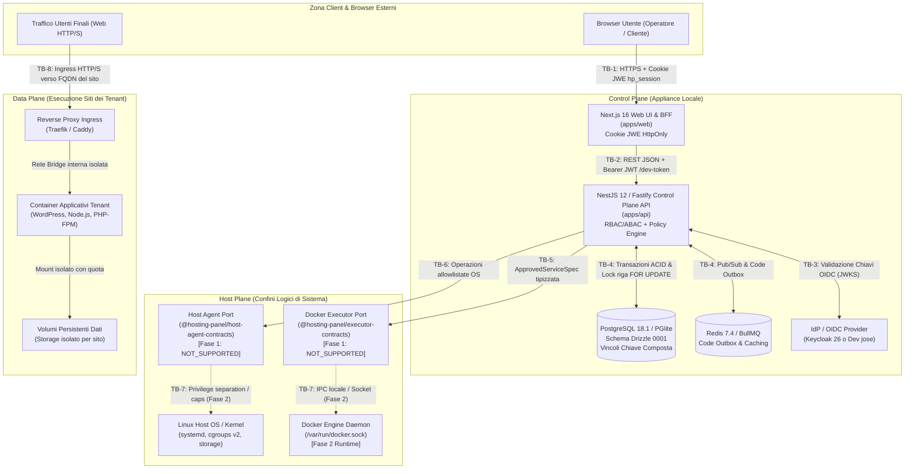

# Diagrammi Architetturali, Confini di Fiducia e Modello ER (`HCP-SPEC-002`)

- **Data:** 2026-11-07  
- **Riferimento di specifica:** `HCP-SPEC-002` §2, §3, §5.1, §8 Step 2  
- **Stato:** Normativo / Approvato  

---

## 1. Mappa dei Piani Architetturali e gli 8 Confini di Fiducia (Trust Boundaries)

L'architettura della piattaforma è rigorosamente suddivisa in tre piani ortogonali:
- **Control Plane**: Interfaccia utente web, API REST modulare NestJS, motore policy RBAC/ABAC, outbox transazionale e persistenza PostgreSQL/Redis.
- **Host Plane**: Confini di esecuzione verso il motore container e i servizi di sistema operativo host (interfacce contrattuali tipizzate).
- **Data Plane**: Flusso applicativo diretto degli utenti finali verso i siti ospitati (ingress reverse proxy, container applicativi, database dei siti, volumi di storage).



### Tabella dei Confini di Fiducia (Trust Boundaries)

| ID Confine | Nome del Confine | Canale / Protocollo | Misure di Sicurezza Applicate |
| :--- | :--- | :--- | :--- |
| **TB-1** | Browser <-> Web BFF | HTTPS / HTTP (127.0.0.1) | Cookie crittografato JWE `hp_session` (`HttpOnly`, `SameSite=Lax`), sanitizzazione perimetrale DTO (zero token o secret nel DOM), protezione CSRF. |
| **TB-2** | Web BFF <-> API Control Plane | REST / JSON su rete interna | Token Bearer JWT verificato tramite `jose`, contesto organizzativo in sessione, separazione rigida dei tre namespace (`/admin`, `/hosting`, `/o/:orgSlug`). |
| **TB-3** | Control Plane API <-> IdP OIDC | HTTPS / OIDC Protocol | Verifica firma crittografica token con JWKS dinamico o emulatore dev `jose`; rifiuto categorico di algoritmi insicuri (`none`). |
| **TB-4** | Control Plane API <-> PostgreSQL/Redis | TCP / Unix Socket locale | Connessioni autenticate, transazioni ACID, vincoli di chiave composta relazionale `(organization_id, id)`, trigger anti-manomissione su audit/revisioni. |
| **TB-5** | Control Plane API <-> Docker Executor | Interfaccia TypeScript tipizzata | Disaccoppiamento assoluto tramite `@hosting-panel/executor-contracts`; specifiche validate `ApprovedServiceSpec`; stub Fase 1 `NOT_SUPPORTED`. |
| **TB-6** | Control Plane API <-> Host Agent | Interfaccia TypeScript tipizzata | Contratto tassativo `@hosting-panel/host-agent-contracts`; diniego esplicito a `hosting_admin` (`AC-F1-03`); stub Fase 1 `NOT_SUPPORTED`. |
| **TB-7** | Agenti <-> OS Host & Docker Daemon | Socket Unix / IPC (Fase 2) | Separazione di privilegi; accesso a `/var/run/docker.sock` confinato; rimozione capability Linux pericolose (`CAP_SYS_ADMIN`). |
| **TB-8** | Ingress <-> Container dei Tenant | Reti Bridge Docker | Segmentazione di rete per `Site`; nessun cross-talk inter-container tra siti differenti; terminazione TLS con certificati dedicati. |

---

## 2. Diagramma Entità-Relazione (Schema Relazionale PostgreSQL Fase 1)

Il modello dati di persistenza è definito in `@hosting-panel/database` tramite Drizzle ORM e codificato nella migrazione canonica `0001_phase1_docker_native.sql`:

```mermaid
erDiagram
    platform_installations ||--o{ hosts : "gestisce"
    platform_installations ||--o{ service_templates : "fornisce catalogo"
    hosts ||--o{ host_allocations : "assegnato tramite"
    organizations ||--o{ host_allocations : "detiene allocazione su"
    organizations ||--o{ sites : "possiede"
    organizations ||--o{ resource_quotas : "soggetta a"
    organizations ||--o{ quota_reservations : "riserva risorse in"
    organizations ||--o{ operations : "registra mutazioni"
    organizations ||--o{ audit_events : "traccia eventi immutabili"
    
    sites ||--o{ domains : "mappato su"
    sites ||--o{ service_instances : "composto da"
    
    service_templates ||--o{ service_instances : "istanziato da"
    
    service_instances ||--o{ stack_revisions : "versionato in"
    service_instances ||--o| observed_states : "osservato in"
    
    stack_revisions ||--o{ docker_resources : "dichiara risorse"

    platform_installations {
        uuid id PK
        varchar version
        varchar mode
        varchar status
        timestamp created_at
        timestamp updated_at
    }

    hosts {
        uuid id PK
        uuid installation_id FK
        varchar name
        varchar hostname
        varchar ipv4_address
        varchar hosting_mode "dedicated | shared"
        varchar status "online | offline | maintenance"
        jsonb hardware_specs
        timestamp created_at
        timestamp updated_at
    }

    organizations {
        uuid id PK
        varchar name
        varchar slug UK
        varchar status "active | suspended"
        timestamp created_at
        timestamp updated_at
    }

    host_allocations {
        uuid id PK
        uuid host_id FK
        uuid organization_id FK
        varchar hosting_mode "dedicated | shared"
        varchar status "active | released"
        timestamp allocated_at
        timestamp released_at
    }

    sites {
        uuid id PK
        uuid organization_id FK
        uuid host_allocation_id FK
        varchar name
        varchar slug
        varchar status "provisioning | active | stopped | degraded"
        timestamp created_at
        timestamp updated_at
    }

    service_templates {
        uuid id PK
        varchar name
        varchar slug UK
        varchar category "web | database | cache | worker"
        varchar version
        jsonb default_spec
        boolean is_active
        timestamp created_at
    }

    service_instances {
        uuid id PK
        uuid site_id FK
        uuid organization_id FK
        uuid template_id FK
        varchar name
        varchar service_type
        varchar status "pending | running | stopped | error"
        uuid current_revision_id FK
        timestamp created_at
        timestamp updated_at
    }

    stack_revisions {
        uuid id PK
        uuid service_instance_id FK
        uuid organization_id FK
        integer revision_number
        varchar spec_hash "SHA-256 immutabile"
        jsonb service_spec
        varchar status "applied | superseding | failed"
        timestamp created_at
    }

    docker_resources {
        uuid id PK
        uuid stack_revision_id FK
        uuid service_instance_id FK
        varchar resource_type "container | volume | network"
        varchar logical_name
        jsonb attributes
        timestamp created_at
    }

    observed_states {
        uuid id PK
        uuid service_instance_id FK UK
        varchar runtime_status "running | exited | restarting | dead"
        varchar drift_status "in_sync | drifted | unknown"
        jsonb inspected_state
        timestamp last_observed_at
    }

    domains {
        uuid id PK
        uuid site_id FK
        uuid organization_id FK
        varchar fqdn UK "canonical lowercase"
        boolean is_primary
        varchar tls_status "pending | ready | error | none"
        timestamp created_at
    }

    resource_quotas {
        uuid id PK
        uuid organization_id FK UK
        integer max_cpu_millicores
        bigint max_memory_bytes
        bigint max_disk_bytes
        integer max_sites
        integer max_domains
        timestamp created_at
        timestamp updated_at
    }

    quota_reservations {
        uuid id PK
        uuid organization_id FK
        uuid operation_id FK
        integer reserved_cpu_millicores
        bigint reserved_memory_bytes
        bigint reserved_disk_bytes
        varchar status "reserved | committed | released"
        timestamp expires_at
        timestamp created_at
    }

    operations {
        uuid id PK
        uuid organization_id FK
        varchar entity_type
        uuid entity_id
        varchar operation_type
        varchar status "queued | processing | succeeded | failed | unknown | cancelled"
        varchar idempotency_key UK
        jsonb payload
        text error_message
        timestamp started_at
        timestamp completed_at
    }

    audit_events {
        uuid id PK
        uuid organization_id FK
        uuid actor_user_id
        varchar actor_role
        varchar action
        varchar resource_type
        uuid resource_id
        jsonb metadata
        varchar ip_address
        timestamp timestamp "immutabile trigger-protected"
    }
```

---

## 3. Tabella dei Vincoli di Proprietà e Integrità Relazionale

I vincoli composti di chiave e di foreign key (`0001_phase1_docker_native.sql`) garantiscono l'impossibilità matematica di orfanizzazione o di associazione cross-tenant:

| Tabella Coinvolta | Vincolo / Definizione DDL | Invariante di Sicurezza e Dominio |
| :--- | :--- | :--- |
| `organizations` | `CONSTRAINT uk_org_slug UNIQUE (slug)` | Garantisce che non possano esistere due tenant con il medesimo slug URL. |
| `sites` | `UNIQUE (organization_id, id)` | Permette la referenziazione composta da parte delle tabelle figlie per forzare l'appartenenza allo stesso tenant. |
| `service_instances` | `FOREIGN KEY (organization_id, site_id) REFERENCES sites(organization_id, id)` | **Invariante BOLA**: Una `ServiceInstance` non può appartenere a un `Site` di un'altra organizzazione. |
| `stack_revisions` | `FOREIGN KEY (organization_id, service_instance_id) REFERENCES service_instances(organization_id, id)` | **Invariante di Revisione**: Una `StackRevision` deve obbligatoriamente appartenere alla medesima organizzazione del servizio. |
| `domains` | `CONSTRAINT uk_domains_fqdn UNIQUE (fqdn)` | **Invariante Host Collision**: Un dominio FQDN non può essere registrato su più siti contemporaneamente, né cross-tenant né nello stesso tenant. |
| `host_allocations` | `EXCLUDE USING btree (host_id WITH =) WHERE (hosting_mode = 'dedicated' AND status = 'active')` | **Invariante `AC-F1-01`**: Impossibile registrare più di una allocazione attiva per un host in modalità Dedicated. |
| `resource_quotas` | `CONSTRAINT uk_quotas_org UNIQUE (organization_id)` | Ciascuna organizzazione dispone di una e una sola tabella di quote aggregate. |
| `stack_revisions` | `TRIGGER trg_stack_revisions_immutable BEFORE UPDATE OR DELETE` | **Invariante `AC-F1-05`**: Le revisioni una volta create sono immutabili (nessun aggiornamento o cancellazione consentito). |
| `audit_events` | `TRIGGER trg_audit_events_immutable BEFORE UPDATE OR DELETE` | **Invariante di Conformità Audit**: Il registro eventi è append-only; qualsiasi tentativo di alterazione o cancellazione solleva eccezione SQL. |

---

## 4. Changelog dello Schema Database

- **Versione 0001 (`migrations/0001_phase1_docker_native.sql`)**:
  - Creazione completa delle 15 tabelle relazionali conformi a `HCP-SPEC-002`.
  - Aggiunta indici su chiavi esterne, indici univoci su `domains(fqdn)`, `operations(idempotency_key)` e `organizations(slug)`.
  - Creazione dei trigger PL/pgSQL di immutabilità su `stack_revisions` e `audit_events`.
  - Predisposizione di funzioni transazionali atomiche: `allocateHostTransactional` (`AC-F1-01`) e `reserveQuotaTransactional` (`AC-F1-07`).
